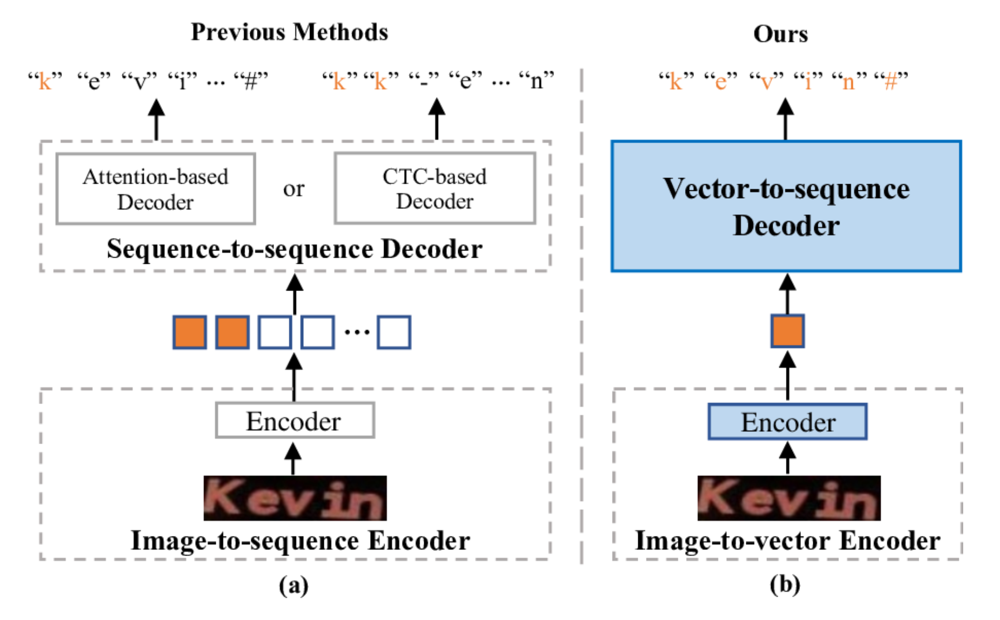
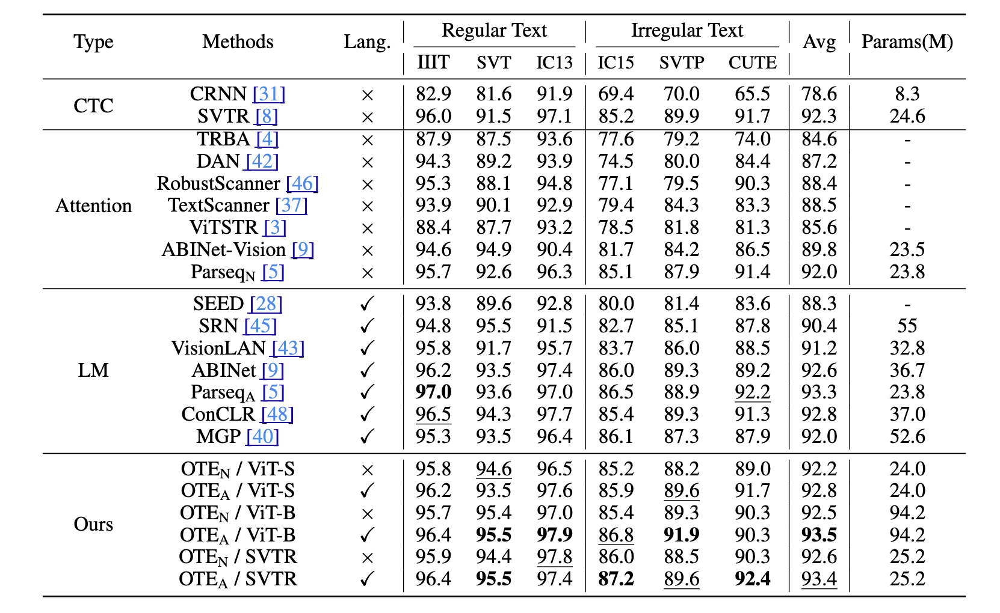
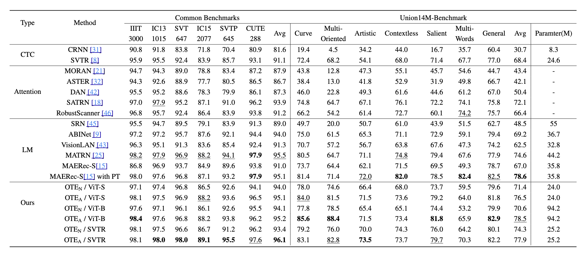

# OTE: Exploring Accurate Scene Text Recognition Using One Token

This repository is an implementation of the paper [OTE: Exploring Accurate Scene Text Recognition Using One Token](https://openaccess.thecvf.com/content/CVPR2024/html/Xu_OTE_Exploring_Accurate_Scene_Text_Recognition_Using_One_Token_CVPR_2024_paper.html). 

OTE introduces a new paradigm for scene text recognition. Instead of relying on a sequence of visual tokens and an alignment process, it first compresses the entire text image into a single global semantic token with an image-to-vector encoder, and then decodes that token into a character sequence with a vector-to-sequence decoder. The central claim of the paper is that **one token is sufficient for accurate scene text recognition**.



## Runtime Environment

The repository includes a Conda environment file at [`ote.yaml`](./ote.yaml).

```bash
conda env create -f ote.yaml
conda activate ote
```

Key dependencies listed in `ote.yaml` include:

- Python 3.12
- PyTorch 2.4.0
- torchvision 0.19.0
- pytorch-lightning 1.9.4
- timm 1.0.8
- hydra-core 1.3.2
- lmdb
- nltk

## Datasets

### Training datasets used in the paper

- [**Synthetic training**](https://drive.google.com/drive/folders/1NYuoi7dfJVgo-zUJogh8UQZgIMpLviOE)
  - MJSynth (MJ)
  - SynthText (ST)
- [**Real-world training**](https://onedrive.live.com/?redeem=aHR0cHM6Ly8xZHJ2Lm1zL3UvcyFBb3RKcnVkdEJyLUs3eEFIam1yNXFsSFNyNVBhP2U9TEpSbEtR&cid=8ABF066DE7AE498B&id=8ABF066DE7AE498B%2114224&parId=8ABF066DE7AE498B%2114222&o=OneUp)
  - Union14M-L

### Evaluation datasets

- Common benchmarks
  - IIIT5k
  - SVT
  - IC13
  - IC15
  - SVTP
  - CUTE80
- Additional challenging benchmarks
  - ArT
  - COCO-Text
  - Uber-Text
- Union14M Benchmark subsets
  - `multi_oriented`
  - `salient`
  - `multi_words`
  - `curve`
  - `contextless`
  - `artistic`
  - `general`

### Expected data layout

The training and validation loaders recursively search for `data.mdb`, while the test loader expects each benchmark subset to be stored as an individual LMDB directory. A workable directory layout looks like this:

```text
data_root
├── train
│   ├── synth
│   │   ├── MJ
│   │   │   ├── data.mdb
│   │   │   └── lock.mdb
│   │   └── ST
│   │       ├── data.mdb
│   │       └── lock.mdb
│   ├── real
│   │   └── ...
│   └── Union14M-L
│       └── full_images
│           └── lmdb_format
│               └── ...
├── val
│   └── ...
└── test
    ├── IIIT5k
    ├── SVT
    ├── IC13_857
    ├── IC13_1015
    ├── IC15_1811
    ├── IC15_2077
    ├── SVTP
    ├── CUTE80
    ├── ArT
    ├── COCOv1.4
    ├── Uber
    ├── multi_oriented
    ├── salient
    ├── multi_words
    ├── curve
    ├── contextless
    ├── artistic
    └── general
```

LMDB conversion scripts are available in [`tools/`](./tools), for example:

- [`tools/create_lmdb_dataset.py`](./tools/create_lmdb_dataset.py)
- [`tools/coco_text_converter.py`](./tools/coco_text_converter.py)
- [`tools/textocr_converter.py`](./tools/textocr_converter.py)
- [`tools/art_converter.py`](./tools/art_converter.py)

## Implemented Models In This Snapshot

In the current repository snapshot, the main OTE implementations that can be directly traced to source code are:

| Config | Backbone | Aggregation | Decoder | Source |
| - | - | - | - | - |
| `configs/train_ote.yaml` | Plain ViT-style encoder | `class_token=true` | AR / NAR | `strhub/models/ote/` |
| `configs/train_ote_svtr2.yaml` | SVTR backbone | GAP (`class_token=false`) | AR / NAR | `strhub/models/ote_svtr2/` |

Key source files:

- [`train.py`](./train.py): training entry point (Hydra + PyTorch Lightning)
- [`test.py`](./test.py): benchmark evaluation entry point
- [`strhub/models/ote/model.py`](./strhub/models/ote/model.py): ViT-based OTE model
- [`strhub/models/ote/system.py`](./strhub/models/ote/system.py): ViT-based training/inference logic
- [`strhub/models/ote_svtr2/model.py`](./strhub/models/ote_svtr2/model.py): SVTR-based OTE model
- [`strhub/models/ote_svtr2/system.py`](./strhub/models/ote_svtr2/system.py): SVTR-based training/inference logic
- [`strhub/data/module.py`](./strhub/data/module.py): data module and benchmark definitions

## Training

### 1. Plain ViT-style OTE

The default config is [`configs/train_ote.yaml`](./configs/train_ote.yaml), which maps to `oteseq`.

```bash
python train.py --config-name train_ote \
  data.root_dir=/path/to/data_root \
  model.pretrain_dir=/path/to/clip_pretrain \
  trainer.devices=2
```

To switch to autoregressive decoding:

```bash
python train.py --config-name train_ote \
  data.root_dir=/path/to/data_root \
  model.pretrain_dir=/path/to/clip_pretrain \
  model.is_ar=true \
  trainer.devices=2
```

### 2. SVTR-based OTE

The default config is [`configs/train_ote_svtr2.yaml`](./configs/train_ote_svtr2.yaml).

```bash
python train.py --config-name train_ote_svtr2 \
  data.root_dir=/path/to/data_root \
  model.pretrain_dir=/path/to/clip_pretrain \
  trainer.devices=2
```

To resume from an existing checkpoint:

```bash
python train.py --config-name train_ote ckpt_path=/path/to/last.ckpt
```

Training outputs are written by default to:

```text
outputs/${model.name}/${now:%Y-%m-%d}_${experiment_name}
```

## Evaluation

Use [`test.py`](./test.py) to evaluate a checkpoint on the benchmark datasets:

```bash
python test.py /path/to/checkpoint.ckpt \
  --data_root /path/to/data_root \
  --device cuda
```

Useful optional flags:

- `--new`: evaluate on ArT / COCO / Uber
- `--complex`: evaluate on the challenging Union14M-Benchmark subsets
- `--batch_size 200`: set test batch size
- `--rotation 90`: apply a rotation angle during testing
- `--cased`: evaluate with a case-sensitive charset
- `--punctuation`: include punctuation in the evaluation charset

Evaluation results are printed to stdout and also saved to:

```text
/path/to/checkpoint.ckpt.log.txt
```

## Paper Results


### Synthetic datasets (MJ + ST)



### Real-world training (Union14M-L)




## Citation

If you find this work useful, please cite:

```bibtex
@InProceedings{Xu_2024_CVPR,
  author    = {Xu, Jianjun and Wang, Yuxin and Xie, Hongtao and Zhang, Yongdong},
  title     = {OTE: Exploring Accurate Scene Text Recognition Using One Token},
  booktitle = {Proceedings of the IEEE/CVF Conference on Computer Vision and Pattern Recognition (CVPR)},
  month     = {June},
  year      = {2024},
  pages     = {28327-28336}
}
```

## Acknowledgement

The project structure follows the general training and evaluation style of Scene Text Recognition Model Hub / PARSeq / MAERec , with OTE-related model implementations integrated on top of it.
